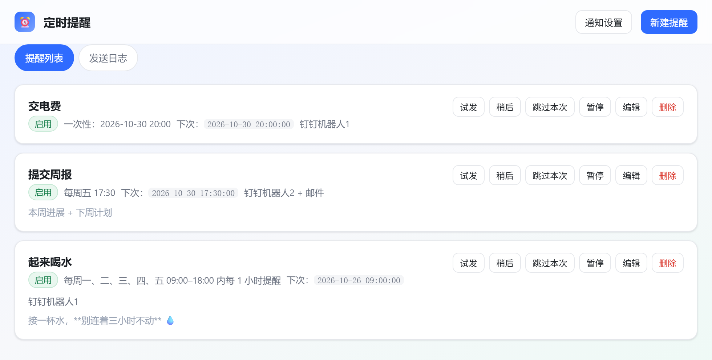
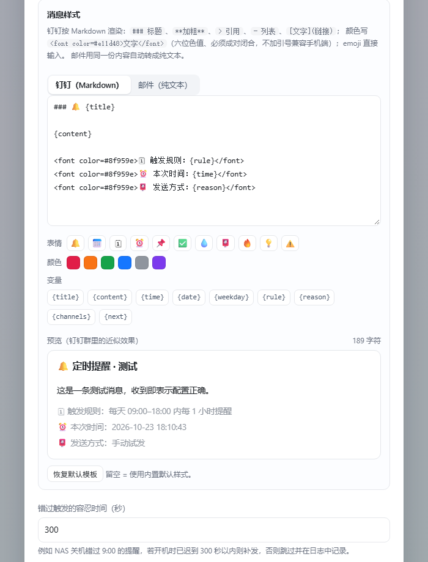
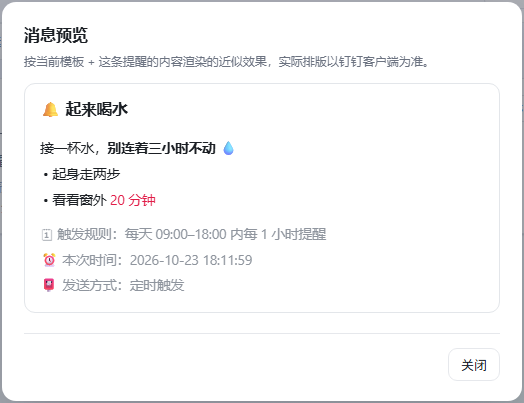

# 定时提醒 · 飞牛 fnOS

**到点把事推到你手机上的自托管提醒服务。** 跑在飞牛 NAS 上（也可以在任何有 Python 的机器上直接跑），按你定的规则通过**钉钉群机器人**或**邮件**发提醒，数据全部留在本地 SQLite，不经过任何第三方服务器。

[](./LICENSE)

-success)


> 这是一个社区作品，**与飞牛（fnOS）官方无关**。「飞牛」「钉钉」等名称仅用于说明适配对象，商标归各自所有者。

---

## 界面



| 消息样式（改完立刻看效果） | 钉钉里收到的样子 |
|---|---|
|  |  |

标题、正文、灰色元信息各自成行——这是钉钉 markdown 的渲染规则，不是排版凑出来的。

---

## 目录

- [它能做什么](#它能做什么)
- [快速开始](#快速开始)
- [通知配置](#通知配置)
- [消息模板（Markdown / emoji / 颜色）](#消息模板markdown--emoji--颜色)
- [数据、备份与安全](#数据备份与安全)
- [常见问题](#常见问题)
- [开发](#开发)
- [设计取舍](#设计取舍)
- [已知限制 / 路线图](#已知限制--路线图)
- [贡献](#贡献)
- [License](#license)

---

## 它能做什么

| 规则类型 | 说明 | 例子 |
|---|---|---|
| 每日时段周期 | 某时段内每隔 N 分钟/小时提醒 | 工作日 09:00–18:00 每小时一次 |
| 每日定点 | 一天一个或多个时刻 | 每天 09:30、17:30 |
| 每周定点 | 指定星期几 + 时刻 | 每周五 17:30 写周报 |
| 一次性 | 指定日期时间 | 10-30 20:00 交电费 |
| 固定间隔 | 从某时刻起每 N 分钟 | 每 90 分钟起身活动 |

通道：**两个钉钉群机器人**（各自一套 webhook，支持加签/关键词，可以分别推到不同的群）+ **SMTP 邮件**（SSL 465 / STARTTLS 587）。每条提醒单独勾选「机器人1 / 机器人2 / 邮件」，互不影响。

还有：暂停/启用、跳过本次、稍后提醒（snooze）、立即试发、下次触发时间预览、发送日志、密钥掩码回显、一次性规则完成态置灰、错过后不补发轰炸、失败重试（5s/15s）、可选访问口令，以及可自定义的消息模板（Markdown + emoji + 彩色文字，带实时预览）。

**架构一句话**：一个进程三班人——HTTP 线程接活、**调度线程**每 15 秒判定到期并入队、**2 个发送线程**真正发网络请求。调度线程永不碰网络，所以 SMTP 卡住 20 秒也不会拖慢别人。

---

## 快速开始

### 方式一：装进飞牛 NAS（推荐）

1. 到 [Releases](../../releases) 下载最新的 `fnnas.reminder.fpk`
2. 飞牛应用中心 → 右上角 **手动安装** → 上传这个文件
3. 装完点一次 **启动**，桌面会出现「定时提醒」图标；也可以直接访问 `http://<NAS-IP>:8388/`

依赖的 `python312` 运行时会由应用中心按 manifest 自动安装。默认端口 **8388**，可在安装时改。

自己打包（想改代码时）：

```bash
# fnpack 是飞牛官方打包 CLI：https://developer.fnnas.com/docs/cli/fnpack/
# Windows 下载的文件没有后缀，重命名为 fnpack.exe 并放进 PATH
./scripts/build_fpk.sh                          # 产物 fnnas.reminder.fpk
FNPACK=/path/to/fnpack.exe ./scripts/build_fpk.sh   # 或直接指定路径
```

`build_fpk.sh` 做的事：生成 64/256 图标 → 把 `app/`（含 `static/` 与桌面入口 `ui/`）同步到 `fpk-src/app/` → 给 `cmd/*` 加执行权限 → 调 `fnpack build`。

### 方式二：本地跑起来（不需要飞牛）

```bash
git clone https://github.com/to371/fnnas-reminder.git
cd fnnas-reminder
python app/server.py          # 需要 Python 3.12+；Windows 用 python app\server.py
# 打开 http://localhost:8388
```

零第三方依赖，不需要 `pip install`。换端口/数据目录、加口令：

```bash
PORT=8388 DATA_DIR=/tmp/reminder python app/server.py
ADMIN_TOKEN=你的口令 python app/server.py   # 之后 /api/* 需要 X-Admin-Token
```

---

## 通知配置

### 钉钉群机器人（可配两个）

1. 钉钉群 → 右上角设置 → **智能群助手** → 添加机器人 → **自定义**
2. 安全设置勾选「加签」或「自定义关键词」（推荐加签）
3. 复制 Webhook（`https://oapi.dingtalk.com/robot/send?access_token=...`）和加签 Secret
4. 应用右上「通知设置」→ 填进**钉钉群机器人 1**（或 2）→ 点「发送测试消息」

两个机器人是独立的配置块，典型用法：

| 场景 | 机器人1 | 机器人2 |
|---|---|---|
| 私人群 / 工作群分开 | 个人提醒 | 团队值班提醒 |
| 单聊群 + 值班群 | 喝水、站起来动动 | 服务器巡检、批处理完成 |

> 用「关键词」方式时消息里必须包含该关键词，程序会在必要时自动追加，但仍建议两边填一致。
> 从老版本升级时，原来的单个 `dingtalk` 配置会自动并入**机器人1**，旧规则照常可用。

### 邮件（QQ / 163 为例）

1. 邮箱网页版 → 设置 → 账户 → 开启 **SMTP 服务** → 获取**授权码**
2. 填：SMTP `smtp.qq.com`、端口 `465`、加密 SSL、账号是完整邮箱、**密码填授权码**（不是登录密码，这是最常踩的坑）
3. 收件人多个用英文逗号分隔 → 点「发送测试邮件」

---

## 消息模板（Markdown / emoji / 颜色）

「通知设置 → 消息样式」可以改推送排版，下方立刻显示钉钉群里的近似效果。两套模板独立：**钉钉（Markdown）** 与 **邮件（纯文本）**，默认长这样：

```
### 🔔 {title}

{content}

<font color=#8f959e>🗓 触发规则：{rule}</font>
<font color=#8f959e>⏰ 本次时间：{time}</font>
<font color=#8f959e>📮 发送方式：{reason}</font>
```

钉钉客户端支持这些子集：

| 想做什么 | 写法 |
|---|---|
| 标题 | `### 文字`（1–6 级，级数越大字号越小） |
| 加粗 / 删除线 / 行内代码 | `**粗**`、`~~删~~`、`` `code` `` |
| 引用块 | `> 一行` |
| 列表 | `- 一项` |
| 链接 | `[文字](https://example.com)` |
| 颜色 | `<font color=#e11d48>红字</font>` |
| emoji | 直接输入 💧 🗓 ⏰ 📮，或点界面上的表情按钮 |

**颜色的三条硬规则**（踩过坑）：六位十六进制、标签成对闭合、**不加引号**。
`color=#FF0000` 电脑+手机都生效；`color='#FF0000'` 只有电脑端生效；`color=red` 完全不生效。

**换行**：钉钉的渲染器只认**空行**分段，单个回车会被吞掉（多行挤成一行）。所以发送前会自动把每个回车补成空行——正文里一行一句照常敲就行，不用自己留空行；连续列表项仍保持紧凑。邮件是纯文本，保持原样。

可用的占位符（点界面上的变量按钮即插入）：

| 变量 | 含义 | 变量 | 含义 |
|---|---|---|---|
| `{title}` | 提醒标题 | `{rule}` | 触发规则的中文描述 |
| `{content}` | 提醒内容（原样直通，可写 Markdown/emoji） | `{reason}` | 定时触发 / 稍后提醒 / 手动试发 |
| `{time}` | 本次触发时间 | `{channels}` | 本次发送的通道 |
| `{date}` / `{weekday}` | 日期 / 星期 | `{next}` | 下一次触发时间 |

- 写错的占位符会**原样保留**，不会静默吞掉，拼错一眼就能看见
- 模板留空 = 跟随内置默认（与默认完全一致时也存空串，将来升级默认样式能自动生效）
- 邮件会把同一份内容转成纯文本（去掉 `###`、`**`、`<font>`），不会出现一堆符号
- 正文超过 8000 字符会截断（钉钉单条消息上限约 20000 字节）

---

## 数据、备份与安全

| 内容 | 位置（飞牛安装后） |
|---|---|
| 程序 | `/var/apps/fnnas.reminder/target`（`TRIM_APPDEST`） |
| 数据库 | `${TRIM_PKGVAR}/data/reminder.db`，常见为 `/vol1/@appdata/fnnas.reminder/data/reminder.db` |
| 日志 / PID | `${TRIM_PKGVAR}/app.log`、`app.pid` |
| 桌面入口与图标 | 应用目录下的 `ui/`（`desktop_uidir=ui`） |

> 路径前缀以你的存储卷为准（`/vol1` / `/vol2` …），可用 `echo $TRIM_PKGVAR` 或看日志里启动时打印的 `data dir`。

- **备份**：直接拷 `reminder.db`（SQLite 单文件，停机或 `PRAGMA wal_checkpoint` 后拷贝最稳）
- **卸载**：数据目录（`TRIM_PKGVAR`）默认保留，重装后提醒还在；想彻底清空需手动删
- **口令**：默认**免密**（按「仅内网使用」设计）——局域网内任何人打开 8388 都能改你的提醒。要收口就设 `ADMIN_TOKEN`，或走 FN Connect / VPN / 反代 Basic Auth
- **不要直接把 8388 映射到公网**
- 口令、邮件授权码、钉钉 Secret 在界面上以掩码回显，读取接口不会返回明文
- Webhook / Secret / 授权码**只存在本机 SQLite**，不会上传到任何地方
- **没有任何遥测**：代码里唯一的对外请求就是你自己配的钉钉 Webhook（`app/notify.py`）和 SMTP 服务器；不检查更新、不上报使用情况，页面也不加载任何 CDN 资源（离线可用）

---

## 常见问题

**装完打开是空白页 / 桌面图标不出来？**
先看日志：`tail -n 50 /vol1/@appdata/fnnas.reminder/app.log`。常见就两类：`python312` 没装上（安装阶段会提示），或 8388 被占用（manifest 里 `checkport = true`，应用中心会拦）。

**ARM 机型能装吗？**
目前 manifest 是 `platform = x86`。把 `fpk-src/manifest` 改成 `platform = arm` 重新打包即可（Python 代码本身无架构依赖，但需要在 ARM 机器上实测）。

**点删除/稍后提醒没反应？**
飞牛应用中心用 iframe 嵌页面，浏览器会拦截原生 `confirm()`/`prompt()`（恒返回 `false`/`null`）。项目已改用页内弹层，并且 `tests/test_frontend.py` 会扫源码防止退回。若你自己改过前端，注意别用原生弹窗。

**钉钉提示 `errcode 300005 token is not exist`？**
Webhook 里的 access_token 不对，或被重置过——去群里重新复制。

**钉钉颜色不生效？**
见上方三条硬规则，多半是加了引号或写了颜色名。

**邮件 535 / 授权码错误？**
QQ/163 必须用**授权码**而不是登录密码，且要先在网页版开启 SMTP 服务。

**改了系统时区，提醒时间没变？**
故意如此：`clock.now()` 固定 `Asia/Shanghai`，不跟宿主机走，避免 NAS 时区设成 UTC 后整体错 8 小时。

**NAS 关机错过的提醒会补发吗？**
开机后 `grace` 窗口（默认 300 秒）内补发一次，超过就跳过并在日志里记「错过」，不会开机瞬间弹十几条。

---

## 开发

```bash
python -m unittest discover -s tests -p "test_*.py" -v   # 72 个单测
python tests/smoke_test.py                               # 57 项端到端（真起服务，约 40 秒）
```

CI（GitHub Actions）在 3.12 / 3.13 上各跑一遍上面两条命令，外加一项「只允许标准库」的依赖体检。

```
fnnas-reminder/
├─ app/                    # 运行时源码（零依赖，直接可跑）
│  ├─ server.py            # HTTP 入口 + 调度线程
│  ├─ clock.py             # 统一时间入口（时区绑定 / 迟到秒数）
│  ├─ rules.py             # 规则引擎（纯函数：rule + 基准时间 -> 下次触发）
│  ├─ store.py             # SQLite（rules / logs / kv，含索引与迁移）
│  ├─ notify.py            # BaseChannel + 邮件/钉钉适配器
│  ├─ template.py          # 消息模板（Markdown / 纯文本 / 预览 HTML）
│  ├─ dispatcher.py        # 发送队列 + 工作线程 + 重试
│  ├─ static/index.html    # 单页 UI（无框架、无构建步骤）
│  └─ ui/                  # fnOS 桌面入口（config + 64/256 图标）
├─ fpk-src/                # fnpack 工程（manifest / cmd×9 / config / 图标）
├─ scripts/                # build_fpk.sh、make_icons.py
├─ tests/                  # 单测 + 端到端
├─ docs/
│  ├─ screenshots/        # README 用图
│  └─ DESIGN.md           # 设计文档：需求、数据模型、接口清单、决策记录
├─ CONTRIBUTING.md        # 开发约定与提交流程
└─ .github/               # CI（3.12/3.13）与安全策略
```

**两条时间红线**（有测试守着，别改回去）：

- 计算迟到必须用 `clock.seconds_late()`（内部 `total_seconds()`）——`.seconds` 会把超过一天的时长截断
- 取当前时间必须用 `clock.now()`——它绑定了 `Asia/Shanghai`，不跟着宿主机时区跑

**改前端注意**：不要用原生 `confirm` / `prompt`（见 FAQ），用页内 `uiConfirm` / `uiPrompt`。

---

## 设计取舍

- **落库轮询而不是内存定时器**：下次触发时间写进 `next_run_at`，调度线程每 15 秒问一次「有没有到期的」。进程重启、NAS 断电只是「错过一些时间点」，不会重复轰炸。
- **规则引擎是纯函数**：`next_after(rule, after) -> datetime|None`，不碰数据库、不碰网络，所以能用单测把「9:00–18:00 每小时」的语义钉死（含跨零点、90 分钟余数、星期过滤）。
- **配置错误不重试**：没填 webhook 时立刻失败并写日志，而不是重试两次让用户干等 20 秒（`ChannelConfigError` 就是干这个的）。
- **只发勾选的通道，没配的自动跳过**：结果分 `sent` / `skipped`（没配，不连网不重试不算失败）/ `failed`（配了但发不出去）。只勾了钉钉的提醒永远不会冒出邮件报错。
- **模板只渲染一次，各端各取所需**：`dispatcher.build_context()` 摊平成字典，再由各通道按自己声明的 `text_format` 渲染。

更细的推导（含数据模型、接口清单、设计决策与版本历史）见 [docs/DESIGN.md](./docs/DESIGN.md)。

---

## 已知限制 / 路线图

- 未实现：全局免打扰时段、规则导入导出、每月某日、钉钉主动节流、节假日调休日历
- 单实例假设：同一份数据库不要同时跑两个进程
- 仅 `x86` 打包；ARM 需改 manifest 后自行打包
- 默认免密，见上文「数据、备份与安全」

---

## 贡献

Issue 和 PR 都欢迎。四条硬约束（零第三方依赖 / 时间只用 `clock.py` / 前端不用原生弹窗 / 改行为要带测试）
和提交流程见 [CONTRIBUTING.md](./CONTRIBUTING.md)，参与前请先读一遍
[CODE_OF_CONDUCT.md](./CODE_OF_CONDUCT.md)。安全问题走 [SECURITY.md](./.github/SECURITY.md)，别开公开 issue。

报 bug 请带上：飞牛版本与机型、`/api/health` 里的版本号、复现步骤、`app.log` 相关片段
（**不要贴 Webhook / Secret / 授权码**）。

---

## License

[MIT](./LICENSE) © 2026 fnnas-reminder contributors
